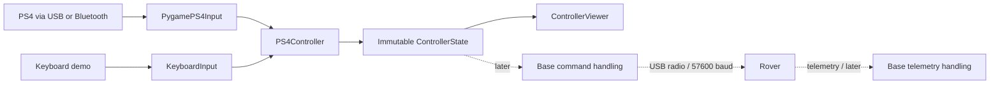

# PING Project

Python input diagnostics for the rover's base station. This first stage reads a
PS4 (DualShock 4) controller and displays its inputs. The controller model is
independent of the hardware adapter and GUI, so each can be developed separately.

## Run

Requires Python 3.10 or newer. From this project folder in PowerShell:

```powershell
python -m venv .venv
.\.venv\Scripts\python.exe -m pip install -e .
.\.venv\Scripts\python.exe -m ping_base
```

Connect the controller with a **USB data cable**, or pair it with Windows over
Bluetooth first. The application waits if no controller is present and reconnects
automatically. The fixed-size viewer shows sticks, analog triggers, D-pad, face
buttons, shoulders, stick clicks, Share, Options, PS, and touchpad click when SDL
exposes it. Touch coordinates, motion sensors, battery level, and rumble are not
implemented. Keep the viewer focused while testing input.

For UI development without a controller:

```powershell
.\.venv\Scripts\python.exe -m ping_base --demo
```

| Keyboard (demo only) | PS4 input |
| --- | --- |
| W / A / S / D | Left stick up / left / down / right |
| T / F / G / L | Right stick up / left / down / right |
| J / K / H / U | Cross / Circle / Square / Triangle |
| Arrow keys | D-pad |
| Q / E | L1 / R1 |
| Z / C | L2 / R2 (fully pressed) |
| 1 / 2 | L3 / R3 |
| Tab / Enter | Share / Options |
| P / Space | PS / Touchpad click |
| Esc | Close viewer |

The keyboard demo releases held inputs when its window loses focus.

## Input state

`PS4Controller.state` is an immutable `ControllerState` snapshot. Every button,
accessed as `state.buttons[Button.CROSS]` for example, has:

| Field | Meaning |
| --- | --- |
| `held` | Currently down |
| `pressed` | Went down during the latest update |
| `released` | Went up during the latest update |
| `toggled` | Flips on each new press; holding does not repeatedly flip it |

`pressed` and `released` last one update. Both can be true for a short tap between
updates; ordered hardware events preserve these taps. The viewer briefly flashes
the button row to make transitions easier to see. The DOWN and UP columns show
the actual one-update flags.

Sticks use `x` and `y` in `[-1, 1]`, with positive X right and positive Y down.
A radial deadzone (default 0.10) removes drift and continuously rescales the
remaining range to a unit circle. L2/R2 analog values are in `[0, 1]`; their button
states use a 0.50 threshold. Trigger analog values are not deadzoned.

Disconnecting zeros all axes and held/toggle states; previously held buttons
receive one release edge. Attaching a controller seeds held state without
generating presses or toggles for buttons already held. Release and press again
to create a new press edge. A changed connection ID resets toggles as well.

## Code structure



| File | Responsibility |
| --- | --- |
| `src/ping_base/controller.py` | Pure Python model, button transitions, toggles, deadzone, snapshots. No pygame dependency. |
| `src/ping_base/inputs.py` | Input source interface, SDL hardware mapping, connection lifecycle, keyboard demo. |
| `src/ping_base/viewer.py` | Render a supplied snapshot; never reads a controller or mutates model state. |
| `src/ping_base/app.py` | Main thread event loop: read input, update model, render, repeat at up to 60 Hz. |

An alternative UI can consume the same model without importing `viewer.py`.
An alternative hardware adapter can return `RawInput` without changing the model.
The adapter contract contains the final held buttons, normalized axes, connection
identity, and optional ordered button changes to preserve brief taps.

Example model use (does not initialize pygame or require a controller):

```python
from ping_base import Button, PS4Controller, RawInput, Stick

controller = PS4Controller(deadzone=0.10)
controller.update(RawInput(connected=True, device_id="example"))
state = controller.update(RawInput(
    connected=True,
    device_id="example",
    held=frozenset({Button.CROSS}),
    left_stick=Stick(x=0.5, y=-0.25),
))
print(state.buttons[Button.CROSS].held)     # True
print(state.buttons[Button.CROSS].pressed)  # True
print(state.buttons[Button.CROSS].toggled)  # True
```

Consume a snapshot once per update in future command handling: `pressed` is an
edge flag, not an event queue. Toggle state is diagnostic state, not an arming or
drive command. The current application never opens a serial port or sends radio
commands. The planned radio link is **57600 baud**; protocol, command handling,
telemetry, and rover control belong to later stages.

## Device diagnostics

```powershell
.\.venv\Scripts\python.exe -m ping_base --list-devices
.\.venv\Scripts\python.exe -m ping_base --device-index 0
.\.venv\Scripts\python.exe -m ping_base --deadzone 0.15
```

Auto-selection chooses the first mapped device named PS4/DualShock or exactly
"Wireless Controller". An explicit index selects any SDL-mapped gamepad, shown
with PS4 labels; indices come from `--list-devices` and may change after plugging
devices in or out. Once opened, the adapter tracks its connection instance ID.
The explicit index is reused when reconnecting.

Pygame uses SDL's standard game-controller mapping rather than hardcoded raw
joystick indices, which can differ across drivers and USB/Bluetooth. If a device
is listed as unmapped, this adapter cannot use it. If it is absent entirely,
check its cable, pairing, and Windows game-controller settings. Steam Input or
DS4Windows may expose a virtual Xbox device; select its listed index explicitly,
or close the remapper and use the physical controller. Driver/remapper support
determines whether PS and touchpad click are available.

API references: [Pygame controller interface](https://www.pygame.org/docs/ref/sdl2_controller.html),
[SDL axis conventions](https://wiki.libsdl.org/SDL2/SDL_GameControllerGetAxis),
[SDL button definitions](https://wiki.libsdl.org/SDL2/SDL_GameControllerButton).

## Verification

```powershell
.\.venv\Scripts\python.exe -m unittest discover -s tests -v
```

Tests cover model transitions, tap preservation, deadzones, immutable snapshots,
disconnect/reconnect, hardware mapping via a fake device, keyboard focus loss,
and the application/viewer using SDL's offscreen display driver.

To check real hardware, start the viewer and test every button, both stick axes,
full and partial trigger travel, and controller unplug/reconnect. Repeat with
Bluetooth if needed. Confirm that a hold produces only one toggle, a second
press clears it, and disconnecting clears held states and axes. Physical USB and
Bluetooth operation must be verified on the target laptop and controller.

