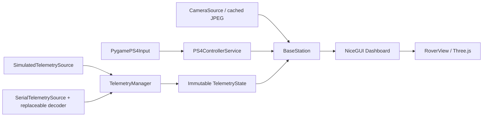
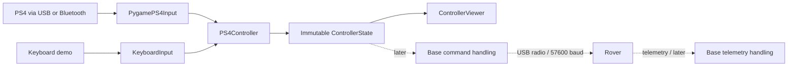

# PING / Rover ground station

A modular Python ground station for the four-wheel PING rover. The interface
prioritizes terrain observation, traction and stability: a central camera with
crosshair and telemetry overlay, an interactive rover model underneath, and a
telemetry column with ground speed, wheel slip, power, thermals and radio health.

**NiceGUI** provides the dashboard and local Three.js scene. Pygame remains the
optional PS4 hardware adapter and standalone input diagnostic tool. The model,
device adapters, application services and presentation are separate objects.

## Run

Requires Python 3.10 or newer. From this project folder in PowerShell:

```powershell
python -m venv .venv
.\.venv\Scripts\python.exe -m pip install -e .
.\.venv\Scripts\python.exe -m ping_base
```

The dashboard opens at [127.0.0.1:8080](http://127.0.0.1:8080). By default it uses
a virtual terrain camera and seeded telemetry at 10 Hz. The virtual rover starts
stationary and responds to keyboard or DualShock input. No hardware is
required. All interface assets are served locally; mobile data or a hotspot is
not needed once dependencies are installed. Keep the terminal running. Stop
with **Ctrl+C**. Use `--no-browser` to start without opening a tab, or `--port 8081`
if another application uses port 8080.

Suisse Intl Light is used for body text and Suisse Intl Medium for labels and
emphasis. The app discovers the installed fonts in Windows' user/system font
folders and serves only those two files locally. Licensed font files are not
copied into this repository. On another computer, use `--font-dir "C:\Fonts"`;
Helvetica/Arial is the fallback when Suisse is unavailable.

### Dashboard controls

The desktop dashboard fits the available viewport (including 1366 × 768 and
1920 × 1080) with a flatter header and camera/model panels that share the
remaining height. Matching left/right columns hold camera tools and telemetry.
The left column scrolls independently and groups the filters with their active
count and summary; additional tools can be added as further sections. Narrow
screens stack these panels below the camera, with scrolling so controls remain accessible.

- Select **Keyboard** under **Virtual drive**. Hold **W/S** or **Up/Down** for
  forward/reverse; **A/D** or **Left/Right** steer, including turning in place.
  Hold **Space** to brake. Click inside the dashboard first if another app has
  keyboard focus. Form fields and connection dialogs do not drive the rover.
- Select **DualShock** to connect the existing PS4 adapter automatically. The
  **left stick** drives and steers; **Cross (×)** or **L2** brakes. Connect the
  controller by USB/Bluetooth; status shows **WAITING** until it is detected.
- Releasing input slows the rover to a stop. Keyboard focus loss, browser
  disconnect, a missing input heartbeat, or controller disconnect apply the
  virtual brake. Input modes are explicit; the two sources are never mixed.
- Virtual position, wheel RPM, speed, heading and terrain attitude share one
  motion model. The camera travels and turns through a fixed procedural world;
  the model's wheels and ground move consistently. The scene stays still at idle.

- **Pause simulation** stops incoming virtual packets; after one second, live
  values clear and the link becomes **STALE**. Resume supplies fresh packets.
- **Connections** switches between virtual telemetry and a USB serial port,
  scans available ports, and selects a baud rate. Switching closes the previous
  receiver and clears its state/history. Camera and telemetry are independent:
  USB telemetry can be inspected with the virtual camera.
- The camera toolbar toggles the crosshair and opens fullscreen video.
- Use **Filters** in the left **Camera tools** column. Every effect is an
  independent checkbox: stack **Enhanced contrast** (local CLAHE), **Edge
  overlay** (yellow Canny outlines), **Noise reduction**, **Sharpen details**,
  and **Invert colors** in any combination. Edge sensitivity and outline opacity
  have separate 0–100 sliders; higher sensitivity reveals fainter edges.
- **Night vision green**, **Amber phosphor**, **White phosphor**, **Thermal
  style (simulated)**, and **Scanlines** add tactical display styling. Vision
  effects blend in their listed order, with a shared **Vision effect mix**
  slider. Thermal style maps image brightness to false color. Inversion follows
  the color effects, outlines remain on top, and scanlines finish the image.
- **Horizon overlay** adds an attitude ladder from fresh rover telemetry and
  the virtual gimbal's tilt; it hides when camera/telemetry becomes stale.
  **Reset** clears every effect and restores the original JPEG. Filter settings
  belong to each browser page, and selected effects remain applied in fullscreen.
  Click the camera after editing filters to resume keyboard shortcuts. All processing stays local.
- Press **Q** to cycle camera zoom through **1× → 2× → 4× → 1×**. Each press
  advances one level; holding the key does not repeat. The current zoom appears
  in the camera overlay, including fullscreen. The shortcut works in either
  drive mode and is ignored while typing or using connection dialogs.
- The virtual camera has a two-axis gimbal. Hold **I/K** to tilt up/down and
  **J/L** to pan left/right at 15°/s, or use the camera's arrow buttons for 1° steps.
  Pan is limited to **±180°**, tilt to **±60°**. The camera image and 3D camera
  mast follow the same mount angles independently of rover movement.
- Press **R** (or the gimbal home button) to return pan and tilt to **0°**,
  keeping the selected zoom. Releasing the keys holds the current angle; loss
  of focus or connection stops movement. Gimbal controls are available for the
  virtual camera, including fullscreen, and work in either drive mode.
- Press **Z** to toggle virtual-camera stabilization, or click either stabilization
  button. The camera shows **STAB ON / OFF**, and the left column shows the same
  state. Stabilization holds camera heading and pitch while leveling roll as the
  rover turns or tilts. I/J/K/L still aim the camera, and **R** returns it forward
  while retaining the stabilization setting. **LIMIT** appears if the mount
  reaches its pitch/roll compensation limits. The marker and Z remain available
  in fullscreen. Holding Z toggles once; typing in fields does not toggle it.
- Drag the 3D rover to orbit, scroll to zoom, and use its reset button to restore
  the view. Pitch, roll and heading follow telemetry. The model is an illustrative
  four-wheel chassis with suspension and a stereo camera mast, not final CAD.
- Hover over wheel slip values for wheel RPM and motor current when available.
  Wheel order is **FL / FR / RL / RR**. Missing optional channels show `—`.

The dashboard labels virtual sources explicitly. A serial port being open does
not count as a healthy link: only complete validated packets produce live data.
Disconnected/stale values show `—`; the last model pose and speed history are
labeled historical. Camera loss covers the last image with an offline message.

### Connect hardware

```powershell
# Receive USB/radio telemetry at the project's planned 57600 baud:
.\.venv\Scripts\python.exe -m ping_base --serial-port COM3 --baud 57600

# Add PS4 monitoring using the existing USB/Bluetooth adapter:
.\.venv\Scripts\python.exe -m ping_base --controller

# USB camera or an OpenCV-supported video stream (OpenCV is included):
.\.venv\Scripts\python.exe -m ping_base --camera 0 --controller
```

The real rover packet format has not yet been supplied. The USB receiver uses a
**provisional newline-delimited JSON contract**, fully described with an example
packet in [the telemetry protocol](src/ping_base/telemetry/PROTOCOL.md). A matching
firmware sender can be connected directly; for a different binary/text protocol,
replace the decoder while keeping the receiver, manager and interface unchanged.
The receiver retries disconnected ports every two seconds. Serial reads are
bounded and nonblocking; OS port-open time still depends on the device driver.

Drive inputs control the **virtual rover only**. Selecting USB telemetry disables
virtual driving; the serial adapter remains receive-only. The app does not
transmit motor commands or implement real traction control. USB camera capture runs in a separate process so a
stalled camera driver cannot block telemetry or the interface. The UI is bound
to the local computer by default; `127.0.0.1` on a phone refers to the phone,
not to this computer.

### Architecture and extension points



| Module | Responsibility / extension point |
| --- | --- |
| `telemetry/model.py` | Frozen samples, source contract, freshness, bounded history, source replacement. No GUI dependency. |
| `telemetry/simulation.py` | Seeded 10 Hz virtual robot, four independent wheel channels, pause/resume. |
| `telemetry/serial.py` | Receive-only serial transport, reconnect, bounded framing and validation. Inject another `TelemetryDecoder` for firmware. |
| `camera.py` | Cached immutable JPEG frames through `CameraSource`; virtual terrain and optional USB/IP OpenCV adapters. |
| `station.py` | Shared lifecycle and polling; all browser clients consume the same services. Optional PS4 service pumps SDL on the main thread. |
| `drive.py`, `keyboard.py` | Explicit keyboard/DualShock selection, browser heartbeat and focus handling, per-client input ownership. No command transport. |
| `motion.py` | Pure Python skid-steer dynamics and immutable shared pose; bounded time step, reverse, differential wheel speed and braking. |
| `dashboard.py` | Camera overlay, telemetry/history, connection dialog and source controls. No direct device polling. |
| `rover.py` | Procedural 3D test rover; accepts any object with attitude/speed fields. |
| `fonts.py`, `theme.py` | Local font discovery and restrained graphite/Suisse design. |
| `cli.py` | Composes services and starts the local server with reload disabled for hardware ownership. |

To add another telemetry transport, implement `TelemetrySource.poll(now)` and
`close()`, then pass it to `TelemetryManager`. Consumers receive immutable
`TelemetryState`; `state.sample` is available only while fresh and connected.
`manager.replace_source(new_source)` swaps it while running. To add a camera,
implement `CameraSource` and inject it into `BaseStation`. The GUI only reads
the latest cached frame. The `/healthz` route reports service state and
`/api/camera/frame` serves the latest fresh JPEG without caching.

## PS4 diagnostic viewer

The original standalone Pygame viewer remains available:

```powershell
.\.venv\Scripts\python.exe -m ping_base --controller-viewer
.\.venv\Scripts\python.exe -m ping_base --controller-viewer --demo
```

Connect the controller with a **USB data cable**, or pair it with Windows over
Bluetooth first. The application waits if no controller is present and reconnects
automatically. The fixed-size viewer shows sticks, analog triggers, D-pad, face
buttons, shoulders, stick clicks, Share, Options, PS, and touchpad click when SDL
exposes it. Touch coordinates, motion sensors, battery level, and rumble are not
implemented. Keep the viewer focused while testing input.

For UI development without a controller:

```powershell
.\.venv\Scripts\python.exe -m ping_base --controller-viewer --demo
```

| Keyboard (demo only) | PS4 input |
| --- | --- |
| W / A / S / D | Left stick up / left / down / right |
| T / F / G / L | Right stick up / left / down / right |
| J / K / H / U | Cross / Circle / Square / Triangle |
| Arrow keys | D-pad |
| Q / E | L1 / R1 |
| Z / C | L2 / R2 (fully pressed) |
| 1 / 2 | L3 / R3 |
| Tab / Enter | Share / Options |
| P / Space | PS / Touchpad click |
| Esc | Close viewer |

The keyboard demo releases held inputs when its window loses focus.

## Input state

`PS4Controller.state` is an immutable `ControllerState` snapshot. Every button,
accessed as `state.buttons[Button.CROSS]` for example, has:

| Field | Meaning |
| --- | --- |
| `held` | Currently down |
| `pressed` | Went down during the latest update |
| `released` | Went up during the latest update |
| `toggled` | Flips on each new press; holding does not repeatedly flip it |

`pressed` and `released` last one update. Both can be true for a short tap between
updates; ordered hardware events preserve these taps. The viewer briefly flashes
the button row to make transitions easier to see. The DOWN and UP columns show
the actual one-update flags.

Sticks use `x` and `y` in `[-1, 1]`, with positive X right and positive Y down.
A radial deadzone (default 0.10) removes drift and continuously rescales the
remaining range to a unit circle. L2/R2 analog values are in `[0, 1]`; their button
states use a 0.50 threshold. Trigger analog values are not deadzoned.

Disconnecting zeros all axes and held/toggle states; previously held buttons
receive one release edge. Attaching a controller seeds held state without
generating presses or toggles for buttons already held. Release and press again
to create a new press edge. A changed connection ID resets toggles as well.

## Controller code structure



| File | Responsibility |
| --- | --- |
| `src/ping_base/controller.py` | Pure Python model, button transitions, toggles, deadzone, snapshots. No pygame dependency. |
| `src/ping_base/inputs.py` | Input source interface, SDL hardware mapping, connection lifecycle, keyboard demo. |
| `src/ping_base/viewer.py` | Render a supplied snapshot; never reads a controller or mutates model state. |
| `src/ping_base/app.py` | Main thread event loop: read input, update model, render, repeat at up to 60 Hz. |

An alternative UI can consume the same model without importing `viewer.py`.
An alternative hardware adapter can return `RawInput` without changing the model.
The adapter contract contains the final held buttons, normalized axes, connection
identity, and optional ordered button changes to preserve brief taps.

Example model use (does not initialize pygame or require a controller):

```python
from ping_base import Button, PS4Controller, RawInput, Stick

controller = PS4Controller(deadzone=0.10)
controller.update(RawInput(connected=True, device_id="example"))
state = controller.update(RawInput(
    connected=True,
    device_id="example",
    held=frozenset({Button.CROSS}),
    left_stick=Stick(x=0.5, y=-0.25),
))
print(state.buttons[Button.CROSS].held)     # True
print(state.buttons[Button.CROSS].pressed)  # True
print(state.buttons[Button.CROSS].toggled)  # True
```

Consume a snapshot once per update in future command handling: `pressed` is an
edge flag, not an event queue. Toggle state is diagnostic state, not an arming or
drive command. The standalone diagnostic viewer never opens a serial port or
sends radio commands. The dashboard's receive-only radio link defaults to
**57600 baud**; firmware protocol and rover command handling remain separate.

## Device diagnostics

```powershell
.\.venv\Scripts\python.exe -m ping_base --list-devices
.\.venv\Scripts\python.exe -m ping_base --controller --device-index 0
.\.venv\Scripts\python.exe -m ping_base --controller-viewer --deadzone 0.15
```

Auto-selection chooses the first mapped device named PS4/DualShock or exactly
"Wireless Controller". An explicit index selects any SDL-mapped gamepad, shown
with PS4 labels; indices come from `--list-devices` and may change after plugging
devices in or out. Once opened, the adapter tracks its connection instance ID.
The explicit index is reused when reconnecting.

Pygame uses SDL's standard game-controller mapping rather than hardcoded raw
joystick indices, which can differ across drivers and USB/Bluetooth. If a device
is listed as unmapped, this adapter cannot use it. If it is absent entirely,
check its cable, pairing, and Windows game-controller settings. Steam Input or
DS4Windows may expose a virtual Xbox device; select its listed index explicitly,
or close the remapper and use the physical controller. Driver/remapper support
determines whether PS and touchpad click are available.

API references: [Pygame controller interface](https://www.pygame.org/docs/ref/sdl2_controller.html),
[SDL axis conventions](https://wiki.libsdl.org/SDL2/SDL_GameControllerGetAxis),
[SDL button definitions](https://wiki.libsdl.org/SDL2/SDL_GameControllerButton).

## Verification

```powershell
.\.venv\Scripts\python.exe -m unittest discover -s tests -v
```

Tests cover model transitions, tap preservation, deadzones, immutable snapshots,
disconnect/reconnect, hardware mapping via a fake device, keyboard focus loss,
and the diagnostic viewer using SDL's offscreen display driver. Telemetry tests
exercise seeded simulation, pause/staleness, framing corruption, invalid values,
partial packets, USB reconnect, bounded history and live source replacement.
Camera tests verify JPEG publication, worker cleanup and stalled-driver shutdown;
station tests verify shared ownership and main-thread SDL lifecycle. These tests
use fake hardware and do not open real serial/camera/controller devices.
Drive/model tests cover motion, steering, reverse, braking, heartbeat expiry,
multiple clients, controller disconnect, shared telemetry/camera pose and serial
mode remaining receive-only. Camera tests also verify idle stability, steering,
reverse retracing and bounded procedural terrain caching.

To check real hardware, start the viewer and test every button, both stick axes,
full and partial trigger travel, and controller unplug/reconnect. Repeat with
Bluetooth if needed. Confirm that a hold produces only one toggle, a second
press clears it, and disconnecting clears held states and axes. Physical USB and
Bluetooth operation must be verified on the target laptop and controller.

